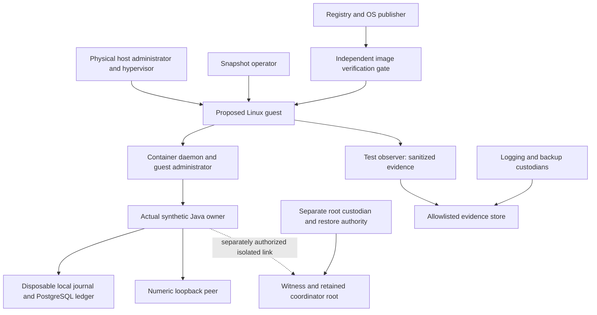

# Controlled Linux VM synthetic testbed: proposed design v1

Status: DESIGNED, not installed or security-certified. Read with the
[acceptance matrix](../operations/phase-13.15-security-acceptance-matrix.md) and
[DRAFT provisioning proposal](../operations/phase-13.15-provisioning-proposal.md).
The conditional candidate is one isolated local Linux VM. Its hardware, hypervisor,
capacity, licensing and network feasibility are NOT_MEASURED. Provisioning consent
and all operational approvals are absent.

## Assets, actors and authority

All credentials are generated fake test values; no real account identity, token,
session or trading data may enter the VM. The JVM, journal, ledger, witness key,
checkpoint, image subject and observations are integrity assets. Hypervisor/root
administrators can potentially inspect memory, replace policy, forge local logs or
restore disks; this design does not defeat a malicious administrator controlling
every authority. Guest-root is not physical-host-root, but the hypervisor controls
the guest. Linux container UID mapping does not map numerically into Windows SIDs.

| Threat/actor | Intended boundary and counterexample |
|---|---|
| Malicious synthetic caller/forged HALT | Exact owner/incarnation/purpose/route/expiry/epoch/signature binding; invalid evidence denies before dispatch and at result acceptance |
| Compromised Java process/exfiltration | AppArmor, seccomp, non-root/userns, read-only storage, default-deny networking and sink allowlist; privileged host inspection remains outside claim |
| Registry/image substitution | Verify exact OS and OCI subjects against authorized signing roots; matching digest alone is insufficient |
| Replay/racing owners/uncertain ACK | Durable witness advancement and local retirement before usable dispatch ticket; zero retry on uncertainty |
| Snapshot/admin tampering | Separate witness/root restore authority; restore-all counterexample retained, no universal protection |
| Heap/crash/forwarding leakage | Private bounded tmpfs, no host bind, declared collectors and canary negatives; unknown sinks block acceptance |
| Observer/clock manipulation | Signed or independently retained evidence receipts and explicit time provenance; local clock/AI output is not human approval or trusted monotonicity |

## Proposed OS, boot and maintenance baseline

Propose Ubuntu Server24.04 LTS amd64, minimal installation, supported GA6.8 kernel
family with current vendor security patches. Exact ISO/image, point release, ABI,
package versions and hashes are deliberately UNVERIFIED until a separately approved
acquisition. Do not install the original unpatched 6.8 release or silently switch HWE.
Ubuntu lists 24.04 standard security maintenance through May2029 and documents the
server GA versus optional HWE tracks: [release lifecycle](https://ubuntu.com/about/release-cycle),
[kernel lifecycle](https://ubuntu.com/kernel/lifecycle). Verify each selected package's
coverage; paid/expanded support entitlement is not assumed.

Future image intake must verify vendor signed checksum metadata with independently
established Ubuntu signing-key identity, then the exact image bytes; retain signature,
key provenance, digest and receipt time. Pin an immutable approved base and package
manifest. [Ubuntu verification procedure](https://ubuntu.com/tutorials/how-to-verify-ubuntu)
is guidance, not a verification performed here. No OS image was downloaded.

Propose signed UEFI boot with Secure Boot enabled and verified in guest plus virtual
firmware configuration on host. Require measured-boot event log/PCR/quote and verifier
provenance before claiming measurement. A restorable vTPM is not an independent
monotonic root; host Secure Boot and guest Secure Boot are separate claims.
[Ubuntu Secure Boot](https://documentation.ubuntu.com/security/security-features/platform-protections/secure-boot/)
describes boot verification, not protection from an authorized hostile hypervisor.

Only required runtime, audit, namespace and test packages; no desktop, broker SDK,
trading application, credential agent or production DB. Disable shared clipboard,
drag/drop, host folders, USB passthrough and unneeded guest integration by approved
configuration, then measure. Console-only administration initially; SSH off by
default. Any later SSH exception requires a management-only source, named key custody,
no password/root login, no agent forwarding and a separately approved ingress rule.

Proposed patch policy: review vendor advisories weekly and before each run; quarantine
for relevant unresolved critical issues; rebuild a new immutable base in a separately
authorized maintenance environment, verify packages, reboot and rerun controls before
use. No update network during tests, no mid-run automatic changes, no rollback of
spent witness state when rolling back software. Keep failed builds/evidence.
[Ubuntu updates](https://documentation.ubuntu.com/server/how-to/software/automatic-updates/)
informs policy; this phase configures nothing.

Time: record UTC, source/server identity, offset/uncertainty, synchronization and
guest/host clock observations before isolation. Test clocks remain injected. In the
offline test network, loss of time confidence, reversal or expiry denies fresh grants;
do not enable public NTP as an undocumented egress exception. Future approved time
service needs authenticated provenance and a declared skew bound. Synchronization
alone is not authentication: [Ubuntu time guidance](https://documentation.ubuntu.com/server/how-to/networking/timedatectl-and-timesyncd/).
No timestamp here advances governance's separate 24-hour review requirement.

## LSM and namespace acceptance design

Choose AppArmor for the proposed Ubuntu guest. Record kernel support, loaded profile
name/version/hash, enforcing mode, actual Java PID/container ID and /proc process
label. Require an authorized one-use positive path and negative file/process/network
operations with correlated kernel audit profile/rule/PID/time. Separate LSM attribution
from denials already caused by seccomp or read-only mounts. Use only isolated synthetic
targets; an inability to attribute a denial keeps that assertion UNVERIFIED. Repeat
after container and guest restart; no complain-mode/unconfined fallback. See
[Ubuntu AppArmor](https://documentation.ubuntu.com/server/how-to/security/apparmor/).

Prefer rootless Docker only if AppArmor attachment/audit, cgroupv2 limits and network
denials work together on the exact selected guest. Otherwise evaluate daemon
userns-remap as a separately reviewed choice, retaining the rootful daemon as a
privileged actor. Rootless puts daemon and containers in a user namespace; remap
keeps daemon rootful: [rootless](https://docs.docker.com/engine/security/rootless/),
[userns-remap](https://docs.docker.com/engine/security/userns-remap/).
No mode is implemented or presumed compatible here.

Capture guest-host /proc/<actual-owner-pid>/uid_map, gid_map, status, namespace inode
and ownership; compare container /proc/self views and daemon subordinate-ID ranges.
Require nonidentity mapping and a disposable guest-host ACL negative/positive pair.
Separately inspect VM-to-physical-host sharing/ACL boundaries; there is no Linux UID
translation across a Windows hypervisor boundary. UID65534 alone is not remapping.
Require CapEff0, NoNewPrivs1, non-root, read-only root, <=8MiB owner scratch,
256MiB owner memory, one CPU, 64 PIDs and private PID/IPC/network namespaces.
Observe effective values, not merely requested Docker flags.

## Network design

Test mode: no NAT, bridge to LAN, public route, host gateway or public DNS. Proposed
private virtual switch has no host service adapter unless separately authorized.
Default deny VM ingress/egress for IPv4 and IPv6, including link-local metadata,
host gateways, multicast discovery and proxy bypasses. No broker DNS lookup/probe.
Positive owner/peer fixture uses numeric loopback in an isolated network namespace.
A future independently administered witness link is an explicit narrow test-network
exception with exact addresses/ports/identity, never general internet access.

Require guest routes/firewall counters and host virtual-switch/firewall observations,
container namespace mapping and actual Java negatives. Use locally controlled sinks
for unexpected IP/port/DNS/redirect/proxy/IPv6/bridge attempts; verify explicit denial
and no peer receipt, not timeout alone. Scrub HTTP(S)/ALL_PROXY and JVM proxy settings,
forbid environment URL overrides; no retry/redirect/supplementary route. Bootstrap
updates and isolated test mode must be mutually exclusive, explicitly approved stages.

## Diagnostics and allowlisted sinks

Proposed owner options: --limit-modules java.base, -XX:+DisableAttachMechanism,
-XX:-HeapDumpOnOutOfMemoryError, -XX:ErrorFile=/scratch/hs_err_pid%p.log;
core dumps disabled by OS limit and verified JVM policy. These are design parameters,
not a launcher or tested flags in this phase. No JFR startup recording, JDWP, agents,
OnError/OnOutOfMemoryError shell hooks or arbitrary environment/JVM options.
Validate semantics against the exact JDK: [Java21 command specification](https://docs.oracle.com/en/java/javase/21/docs/specs/man/java.html).

Separate diagnostics fixture may intentionally enable bounded OOM heap dumps within
24MiB heap/48MiB private tmpfs/256MiB container. Canary-bearing heap is expected there;
scan in place, export only digest/size/boolean, never raw memory. Require forbidden-path,
attach, native-error fallback, uncaught-exception and changed-sink negatives. Root
and host binds remain forbidden; tmpfs disposal is not physical secure erase.

Allowlist only outcome/schema/send counts on stdout/stderr, bounded local daemon
capture and sanitized test/audit evidence. Raw bodies, credentials, signed assertions,
bearer values and account-like payloads prohibited. Proposed Packaging/logging
custodian must identify exact guest/host/CI/backup destinations, ACLs, encryption,
retention and deletion/audit. Proposed default: raw sanitized diagnostic logs <=7 days,
<=100MiB/run; immutable sanitized failure/decision evidence retained until explicitly
reviewed disposition. These are unapproved policy proposals, not discovered settings.
No external forwarding. Unknown Desktop/host collectors, crash exporters, CI uploads,
VM snapshots or backups remain blockers until independently inventoried. A local
zero-hit scan does not certify external sinks. Secrets never enter argv/environment.

## Witness and recovery design

Keep local journal/ledger disposable. A proposed witness root must have distinct
administrative credentials, restore authority, storage and checkpoint custody outside
the owner's VM and snapshot domain. No actual custodian or second machine is supplied.
A second VM controlled by the same snapshot administrator is not sufficient evidence.
With a sole operator, genuine administrative independence remains UNVERIFIED; do not
rename separate files or accounts as independent authority.

Bind durable attempt ID, request/owner incarnation, HALT epoch, prior/next witness
checkpoint and signed acknowledgment before local dispatch ticket. Missing/invalid/
stale/conflicting signatures, clock uncertainty, root loss, unavailable witness or
lost ACK deny dispatch and quarantine; never automatically reset spent IDs or clear
quarantine on restart. Terminal outcomes do not renew permission.

Future tests: local single/dual-store restore with surviving witness (receipts stay1),
full-root restore (two grants possible, NO HTTP), witness kill/restart, privileged
snapshot restore, coordinator loss/conflicting key, two JVM races/replacement and
lost commit/dispatch ACK. Classify NOT_DISPATCHED/MAY_HAVE_DISPATCHED/OBSERVED_COMPLETED
only from fixture evidence. Software signing is not monotonic hardware; physical
power loss, malicious all-authority restore and multi-host consensus stay unproven.
