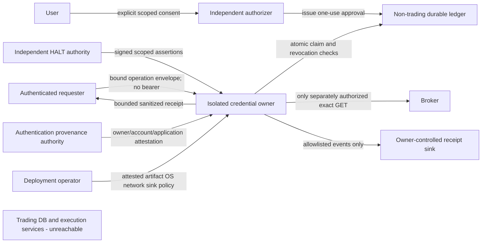

# Credential-owner service boundary

OwnerBoundary.v1, 2026-10-11. Supports DiagnosticAssuranceContract.v2 draft 1.
Design only; no live service, loader, channel, ledger or deployment implemented.
Preferred architecture C, conditional on independent authentication and deployment
proof. Operational NO_GO; AUTHENTICATED_OWNERSHIP_NOT_ESTABLISHED.

## Independent architecture decision

| Dimension | A: JVM-local handoff + trading DB observer | B: DB-free JVM receiving a credential | C: isolated DB-free owner executes narrow read |
|---|---|---|---|
| Attack surface | Trading classes, lifecycle/runners, DB observer, execution in same trust domain | Smaller potential runtime; new credential ingestion and transfer channel | Small operation API plus auth/attestation/ledger channels; requires strong service isolation |
| Credential exposure | Shared trading-process memory, agents and dumps | Export source plus transit plus destination; copied bearer broadens custody | Owner memory only during read; requester gets no credential; privileged host still trusted |
| Operational burden | Existing process simpler, but global writer exclusion is difficult | Packaging plus secure transfer, dual custody and revocation | Highest: separate identity, legitimate auth lifecycle, keys, ledger, attestor, sink and network controls |
| Restart | Private references lost; process budget resets | Needs retransfer/restore, forbidden here | Session lost and all old owner-incarnation approvals denied; consumed ledger survives |
| Proof strength | Existing tested local guards and snapshots; cannot prove absent intervening/global writers | Process isolation can limit DB access; transfer does not prove legitimate ownership | Nonexporting ownership and narrow delegated operation can align authority with claim; no global invariance |
| Feasibility now | Existing synthetic harness; live preconditions absent | No approved credential transfer; reject as ownership design | Feasible design only; authenticated origin and minimal artifact absent |
| Decision | Retain unchanged for old contract, reject as new DB-free boundary | Reject credential transfer; a minimal JVM remains a possible physical packaging choice for C | Prefer because it removes requester bearer custody and trading authority from read execution |

C is independently preferred for least credential exposure and enforceable authority
separation, despite greater operational burden. A service wrapping the existing
trading JVM is A, not C. B's copied token cannot become independently proven
provenance by adding TLS. C is rejected for operation until all missing controls
are built and independently certified; this is not a feasibility waiver.

## Trust boundaries and authorities

User authorizes purpose/account privately; requester cannot self-authorize.
Authorizer authenticates both principals, verifies required human approvals and
issues scope, not broker credentials. Owner protects session and enforces every
gate even against a malicious requester. Broker is trusted for authentication and
response origin, not for inferred collateral eligibility. Provenance authority
independently verifies authentication event and account/application binding.
HALT authority is administratively separate from requester/owner and observes the
complete execution-capable runtime set. Deployment operator enforces isolation
but cannot replace user approval or assert a broker identity from a local flag.
Logging sink operator accepts only the allowlisted schema; no raw exception channel.

Separate signing keys, roles and administrative scopes for authorization,
provenance, HALT and deployment certification; one role's signature cannot satisfy
another. Authenticate control channels with reviewed mutual identity verification
(e.g. pinned mTLS); no IP-only trust, arbitrary key discovery or transferable bearer
capability. Authenticate audience and exact owner incarnation at both endpoints.
Compromise of host/admin, owner code, broker, authority or key can invalidate its
claims; cryptography cannot prove an issuer told the truth. Deny on conflict or
missing independent evidence rather than synthesizing a replacement attestation.

## Legitimate authentication origin: proposed future lifecycle

No already-authenticated isolated owner has been demonstrated. A future mechanism
would require a separately authorized, broker-compliant interactive user login
owned from its beginning by the isolated service, under its registered application
and callback identity. The user completes any broker-required MFA with the broker.
The owner binds a single-use login transaction to authenticated user intent, state,
callback, application and its boot incarnation, validates the callback and exchanges
only that transaction under a separately approved authentication budget. Independently
validated broker account/application evidence must match the user's intended account
before any session can be admitted. This is a requirements design, not certification
of current broker protocol compliance; that must be verified in the later auth review.

The current repository is evidence of why it cannot simply be reused wholesale:
KiteAuthenticationAdapter.exchange(String) posts /session/token and checks returned
api_key; KiteAuthenticationUseCase.complete(String,String,String,String) calls
installAndValidate, store.save and initializeInstruments. restore() loads durable
tokens and can clear storage; reset() clears storage. Those trading lifecycle
dependencies are outside the new boundary. Source review does not execute them.

The proposed enrollment mode must be inaccessible to diagnostic requesters, have
separate explicit authorization and egress policy, and finish before read admission.
Seal the same in-memory owner into read-only mode and revoke enrollment authority;
if this phase transition cannot be independently verified, deny. No login/profile/
exchange endpoint is added to the one-read budget. No automatic transition back
to enrollment after rejection/expiry. Application-secret provisioning is a separate
reviewed secret-management problem, never an environment/file/CLI token workaround.

Never restore a trading token, scrape cookies, bypass MFA, copy encrypted DB rows,
import a portable KiteSession or start the trading application. Owner retains the
new session only in memory; no requester export, disk token cache, token-store write
or automatic recovery. Crash/restart loses session and revokes that incarnation.
No token/session migration to a failover replica. Expiry is the earlier of verified
broker expiry and local policy; authentication rejection, explicit revocation,
owner compromise or session replacement invalidates authority immediately. Remote
broker revocation, if later needed, requires its own authorization; this diagnostic
never calls a revocation endpoint or assumes local invalidation logs out the broker.

Provenance assertion binds issuer/key/version, protected intended-account and app
references, independently verified authentication event, owner artifact/identity/
incarnation, session epoch, consent scope, issue/expiry, revocation and audience.
No token hash or account identifier enters public receipts. A UUID, authenticated
KiteSession fixture, profileValidated(), official-origin label or bearer handoff
is not independent proof. Missing provenance returns
AUTHENTICATED_OWNERSHIP_NOT_ESTABLISHED and NO_GO.

Trusted time uses an independently maintained UTC source with measured uncertainty
and a local monotonic timer. Proposed maximum uncertainty is one second; deny if
the entire uncertainty interval is not inside validity bounds. No skew grace beyond
expiry. Clock rollback, forward jump beyond validity, stale synchronization or
unknown uncertainty denies. Restart requires reacquiring time trust and durable
epoch floors, never trusting a fresh process's empty cache. These are proposed
policy bounds requiring reviewer approval, not measured host clock guarantees.

## Cross-process one-use ledger

Preferred durability boundary: independent non-trading authorization service with
a linearizable, synchronously durable store, separate identity/storage/network
administration from trading PostgreSQL/Redis. The diagnostic has only a narrow
authenticated claim/check API; no generic SQL/storage access. DB-free means no
trading DB access, not absence of all persistence anywhere. Ledger contains no
broker credentials, raw account IDs, balances or trading mutations. Protected
opaque account/session bindings resolve within the trusted authority boundary.

Logical immutable record: approval ID; contract/policy digests; authorizer;
requester; exact owner and incarnation; protected account/app/session epoch;
literal method/endpoint/purpose; not-before/expiry; budget=1; revocation generation;
ledger epoch. Mutable fields: ISSUED/CONSUMED/REVOKED/EXPIRED, claim identity/time,
and bounded outcome. No state transition returns to ISSUED.

Claim algorithm, specification only:

1. Authenticate channel and bind invocation, owner incarnation and requester.
   Validate envelope, independent evidence and trusted time. Reject unknown fields.
2. In one linearizable transaction, compare every immutable binding, state=ISSUED,
   current revocation generation and validity. Atomically set CONSUMED and commit
   durably before acknowledging. Concurrent revocation and claim have one order;
   pre-dispatch checks must also catch a revocation after claim.
3. Return one dispatch grant to that live invocation only. The owner couples it
   to a local non-reusable execution guard. Duplicate delivery cannot recover a
   dispatch grant; a status read returns only SPENT. Lost commit acknowledgment
   means no dispatch and no reopening, even if commit is later confirmed.
4. Immediately recheck session, HALT, authorization/revocation, environment and
   sinks. Any failure leaves CONSUMED. Dispatch once, then postcheck and sanitize.
   Final outcome updates are monotonic metadata, never a retry authorization.

| Failure/race | Required behavior |
|---|---|
| Duplicate request or concurrent replicas | Unique approval key and atomic comparison yield at most one committed claim; wrong incarnation always denies |
| Two threads in winning owner | Invocation-bound local execution guard permits one send only |
| Crash after claim but before send | Spent; zero actual sends possible; never recover the send |
| Crash after send / timeout / lost response | Spent and INDETERMINATE; no replay or fallback endpoint |
| Ledger unavailable, partition, uncertain quorum | Deny; no local cache/offline claim fallback |
| Replica failover | New incarnation cannot use old approval/session; no token transfer, no budget replenishment |
| Store rollback or restored backup | Fence old ledger epoch, invalidate all affected approvals and require independent recovery; never serve from a stale restored ISSUED row |
| Audit replay or deletion | Audit is evidence only, never input for issuing grants; append integrity/sequence anchored outside mutable store; missing continuity denies |
| Expiry/clock skew | Authority and owner both enforce bounded trusted-time validity; uncertain time denies |
| Concurrent revocation after final check | Postcheck rejects result; checks cannot retract a request already sent; no claim of atomic network/revocation ordering |

Durability assumes the reviewed quorum/storage honors acknowledged commits and
administrators cannot silently roll back the epoch. Certification must test that
assumption. Retain spent IDs until all possible acceptance windows and signed
envelopes are invalid, then preserve durable epoch tombstones; never recycle IDs.
Approval issuance requires a new explicit human decision, never automatic renewal.
At most one authorized dispatch attempt is the claim; exactly-once broker delivery
or execution is not promised over an ambiguous network.

Alternatives: an owner-local fsynced journal with exclusive OS locking can suit one
host but does not solve multi-host failover/rollback without equivalent fencing;
an ephemeral cache/static AtomicBoolean fails restart durability; trading DB/Redis
violates this boundary. If all persistence is forbidden, use fail-closed lifetime
authorization with an independent authority permanently retiring the incarnation
on crash/uncertainty, or no operation. Without durable independent retirement,
strict cross-restart one-use cannot be claimed and the only safe result is DENY.

## Independent HALT attestation

Require issuer/key ID, schema, audience, contract digest, owner incarnation,
approval challenge, complete deployment/runtime instance-set digest, per-instance
HALTED_KNOWN and disabled execution authority, monotonically increasing epoch,
issued-at/expiry and revocation generation. Sign canonical domain-separated data;
trusted keys are provisioned independently. Maximum proposed lifetime 30 seconds,
shortened by other validity bounds; verify before dispatch and again before result
acceptance using separate stage-bound fresh challenges.

Unknown issuer/instance, missing coverage, stale/future/forged assertion, conflicting
runtime state, replayed challenge, older epoch, unknown revocation or signature/key
policy failure denies. Challenge-consumption and minimum epoch survive verifier
restart in the independent authority; otherwise restart denies. Attestor must
observe actual execution-capable instances, not sign requester-supplied halted=true.
Coverage drift invalidates the assertion. Revoked/compromised key invalidates all
outstanding assertions; explicit independent recovery is required.

RuntimeTradingHalt.knownHaltedAt(Epoch) supplies local evidence only; its unavailable
startup signal denies observation while execution remains fail-closed. Never call
resume, arm or execute to obtain attestation. HALT is necessary, never read permission.
TOCTOU remains: pre/post checks cannot prove no transient change absent trustworthy
epoch continuity. Live attestation remains NOT_ESTABLISHED.

## Minimal runtime and reachability specification

| Surface | Future allowlist | Required exclusions and independent proof |
|---|---|---|
| Entry point | Dedicated owner bootstrap with sealed read mode and exact operation handler | No TradingCoreApplication, OperatorConsoleApplication, KiteRestDiagnostic, Boot scanning, ApplicationRunner, scheduler, Actuator |
| Runtime dependencies | Minimal JDK, reviewed TLS/HTTP, strict JSON/decimal mapper, clock, signature verifier, narrow control clients, bounded receipt encoder | No JDBC/PostgreSQL/Redis/Flyway, token repositories, order/risk/permit/operator/strategy/reconciliation/WebSocket classes or general execution/URL APIs |
| OS identity | Dedicated unprivileged service identity, no trading groups or debug/attach/process-control rights | No administrator/root, inherited credential access, Java agents, JFR sensitive captures, ptrace/debugger or process spawning |
| Filesystem/mounts | Immutable reviewed artifact/trust roots/policy; private bounded volatile workspace and approved sanitized receipt sink | No .env, user home, trading volumes, token stores, shared writable mounts, Docker socket, host path aliases/reparse escape |
| Environment | Closed deployment manifest of only necessary OS/JDK location, locale/time and nonsecret policy reference; reject extra variables by name without printing values | No broker/trading DB secrets, proxy vars, JAVA_TOOL_OPTIONS/JDK_JAVA_OPTIONS/_JAVA_OPTIONS agents, arbitrary classpath/config, inherited shell credentials |
| Network | Deny default; exact broker TLS host for approved read plus separately allowlisted identity/ledger/HALT/time control channels | No trading PostgreSQL/Redis, trading service RPC, metadata endpoints, general Internet, alternate DNS/proxy tunnels, host.docker.internal bypass |
| HTTP policy | Fixed GET route in reviewed client, verified TLS, no retries/redirects/auth challenge/cookies | L3 egress cannot enforce encrypted method/path; endpoint controls must also exist in the owner; proxies cannot retry or inspect bodies |

Static tests must inspect complete transitive artifact/SBOM, class loadability,
service-loader entries, reflection/config hooks and entrypoint dependency closure,
not merely direct ArchUnit calls. Current plain classifier still packages broad
application authority; KiteRestTransport has order methods and KiteSession has
credential/market-data paths. Reuse narrow parsing/transport logic only through a
separately reviewed extraction; no such extraction is performed here.

Runtime reachability tests must launch only the future synthetic minimal artifact
under intended OS/container policy against disposable canary DB/Redis/writer RPC
and loopback broker/authority peers, assert zero startup side effects and denied
connects/files/agents, exercise mounts/environment variants and record observed
socket/child-process/class-load evidence. Never probe the development trading DB.
Host/WSL/container and remote routes must all be covered. These tests are specified,
not run against a nonexistent artifact. Own-process noninterference is DESIGNED.

## Credential and logging containment

Complete sink inventory and proposed default policy:

| Sink | Rule |
|---|---|
| stdout/stderr, IDE output | Disabled for owner runtime; only launcher-level bounded exit status, never owner objects/errors |
| Java appenders | One explicitly instantiated receipt encoder/sink; no console/file/network add-ons or dynamic reconfiguration |
| HTTP wire/header/TLS logs | Disabled; reject DEBUG/TRACE and sensitive diagnostic facilities before startup/dispatch |
| Tracing/metrics/JMX/Actuator | Disabled; no labels, body/header captures, exporter or management endpoint |
| Heap/core/crash dumps, JFR, debugger/agents | Disabled and independently enforced by host policy; unknown platform crash capture denies admission |
| Windows Event Log/WER | No owner payload/error forwarding; independently verify OS collectors and crash policy |
| Docker/container logs | No raw stdout stream, external log driver or collector; runtime/operator must attest actual driver policy |
| Proxies/service mesh | No TLS interception/header/body access, trace propagation or retry; unknown proxy denies |
| CI artifacts | Synthetic markers only; no real owner execution, environment dump, credential/session or response artifacts |

Only allowed owner event fields: schema/contract version, fixed endpoint enum,
bounded phase/outcome/reason enum, conservative attempt count 0/1, provenance
classification and UTC receipt time. No free text, stack/cause chain, header/cookie,
Authorization, session/capability serialization, account IDs or identity-derived
hashes, raw balances/payloads. Protected control envelopes use dedicated reviewed
encoders and authenticated channels; they are never general session serialization
and never logged. Generic reflection/Java serialization is prohibited for credential,
session and capability objects; toString redaction alone is insufficient.

Proposed sink owner: dedicated service identity; independent packaging/logging
reviewer verifies ACLs and operator audit access. Default retention for sanitized
receipts is seven days, no replication/backups, bounded size and deletion by sink
owner; any alternate policy requires explicit approval. Ledger spent-state retention
is separate from logging retention and must not lose replay protection. No live
sink owner, retention deployment or approval has been attested here.

Startup and immediate pre-dispatch enumerate appenders/levels/exporters/agents,
OS collectors, dump policy and effective proxy/container/IDE settings against signed
deployment policy. Any unknown sink or drift denies, burns an already claimed
attempt and quarantines results. Prevent configuration mutation for the operation;
postcheck drift rejects receipt. Source-level redaction cannot certify external
sinks or compromised privileged capture. JVM memory zeroization is not guaranteed.

## Actual source boundary reviewed

Production base: apps/trading-core/src/main/java/com/kitehybrid/platform/.
Kite classes below are in broker/infrastructure/kite; none is invoked live.

| Actual method/class | Review consequence |
|---|---|
| KiteEquityReadHarness.run(); constructors require KiteEquityReadIntegrity | Cannot omit/stub capture() to turn old harness into v2 |
| KiteEquityReadHandoff.consume(Owner,Recipient,String,String); inspect(Owner,Recipient) | Private reference equality and AtomicBoolean are local, not authenticated RPC |
| KiteEquityReadIsolation(Clock,Duration,BooleanSupplier).valid() | Synthetic witness lease, maximum 30 seconds; not host or HALT attestation |
| KiteEquityReadIntegrity(Connection).capture() | SELECT/SHOW role/session/content/schema observation; no global preventive authority |
| KiteEquityReadRequestFactory.createRequest(URI,HttpMethod), official(), loopback(URI,Duration) | Exact local route/one-execute controls; static REAL_PROCESS_ATTEMPT resets with JVM |
| KiteEquityMarginReadAdapter.read(), observation(Snapshot) | Session/owner-bound receipt; provenance enum depends on origin label |
| KiteSession.install(KiteAccessToken), profileValidated(), authorization(), executionIdentity() | Synthetic authentication is possible; UUID and enum cannot establish independent provenance |
| KiteInfrastructureConfiguration.restoreKiteAuthentication(KiteAuthenticationUseCase) | ApplicationRunner triggers restore; exclude normal Spring composition |
| broker/application/auth/KiteAuthenticationUseCase.restore(), complete(...), reset() | Store/profile/instrument effects incompatible with diagnostic lifecycle |
| shared/application/RuntimeTradingHalt.knownHaltedAt(Epoch) | Known local state, not remote all-runtime certificate |
| operator/application/OperatorExecutionService.arm(OrderId,Duration), resume(Epoch), execute(OrderId) | Execution/arming dependencies categorically excluded |
| bootstrap/TradingCoreApplication.main(String[]), OperatorConsoleApplication.main(String[]) | Never launched for this review or proposed diagnostic |

Decision provenance: baseline source, four prior architecture documents, Phase
13.5A-E validation, Phase F plan/decision/validation and WebSocket follow-up, old
Stage B approval/abort, and fresh regression results in Phase G validation. No
external broker/account evidence was collected. All four role approvals PENDING.
