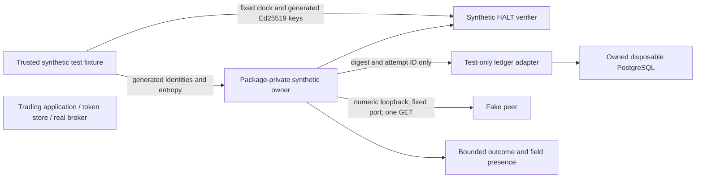

# Synthetic credential-owner prototype v1

This is an isolated engineering fixture, not a credential-owner deployment. The
standalone Maven child `apps/synthetic-credential-owner` is outside the root reactor
and trading-core dependency graph. Its runtime classes are package-private and use
only the JDK; there is no launcher, main method, Spring wiring, real credential
loader, authentication flow, broker client, JDBC adapter or service listener in the
runtime JAR. Tests supply generated synthetic entropy, identities, keys and clocks.
No credential value is imported, sent to the fake HTTP peer, logged or stored.

The exact parent proposal remains DiagnosticAssuranceContract.v2 draft 1,
`5B9F1E717DD444CE5BBF6697012BF11887DBA780FB8C1099AC24D0A5D7D79CE7`, PENDING.
Its fingerprint binds request digests as document identity only, never approval.
The frozen implementation plan is [phase-13.6-plan.md](../operations/phase-13.6-plan.md).

## Existing implementation boundary

The existing classes remain unchanged under
`apps/trading-core/src/main/java/com/kitehybrid/platform/`:

| Existing component | Reason excluded from prototype |
|---|---|
| KiteEquityReadHarness / KiteEquityReadHandoff | Trading HALT and authenticated-session dependencies; JVM-local handoff is not independent provenance |
| KiteEquityReadIsolation / KiteEquityReadIntegrity | Existing assurance includes trading-state observation; integrity uses JDBC |
| KiteEquityReadRequestFactory | Spring/Apache HTTP plus official broker route and process-local guard |
| KiteEquityMarginReadAdapter / KiteRestTransport | Real broker transport; general transport includes broader broker/order operations |
| KiteSession / KiteAuthenticationUseCase | Real session lifecycle, token-store restoration and authentication follow-up effects |
| RuntimeTradingHalt | Local trading runtime guard, not external live HALT authority |

None is reused, subclassed, instantiated or imported by the new artifact. The
standalone POM inherits version/plugin management only. PostgreSQL, Testcontainers
and JUnit dependencies have test scope. `DisposableLedger` and `LedgerWorker` are
test classes and cannot appear in the runtime JAR.



There is deliberately no edge to T. Fixture construction and the supplied caller
principal are trusted **synthetic** inputs, not an implemented network identity
provider. Constructor identities must be explicitly tagged SYNTHETIC. A supplied
claim of broker authority denies. This tests scope enforcement, not authentication
origin. The fixture pins the owner incarnation; a restarted real service would need
independent process fencing and fresh incarnation issuance. No live service exists.

## Attempt and HALT protocol

Request SHA-256 uses length-framed UTF fields: proposal, prototype version, UUID,
owner incarnation, caller, recipient, synthetic account, purpose, exact GET/URI,
issued time, expiry, HALT epoch and SYNTHETIC_ONLY authority. Maximum validity is
30 seconds. No credentials are part of that digest or its persisted data.

The test adapter checks its unique fixture marker and PostgreSQL fsync,
full_page_writes and synchronous_commit settings on every connection. Its only URL
is numeric loopback at the port supplied by its owned Testcontainer, to database
`synthetic_owner_only`; environment variables cannot choose a DB or credentials.
There is no trading schema, Flyway migration or production adapter.

```text
ABSENT -> durable unique RESERVED -> transactional CONSUMED -> bounded terminal outcome
                     |                     |
                     +---- permanently spent ----+
```

A unique primary key wins once across connections/processes. A reservation is an
irreversible spent marker, never a recoverable dispatch grant. Only the invocation
that receives a certain CONSUMED commit acknowledgment may continue. Rollback
after reservation leaves RESERVED; lost consume acknowledgment leaves CONSUMED but
returns no grant. Process death after acknowledgment permits zero dispatches; a
lost response permits no replacement dispatch. Terminal-write failure returns
OUTCOME_UNKNOWN without changing consumption. There is no delete, TTL, reset,
retry, recovery grant or automatic renewal path.

Connection failure before a durable reservation returns no grant. The API does not
retry. Persistence cannot prove a reservation exists when no write was acknowledged;
external issuance/retirement of uncertain pre-reservation requests is not implemented
as a production control. At-most-once dispatch for durably reserved attempts is
tested; universal no-reissue under arbitrary issuer/ledger partitions is not certified.
Two workers/processes share one primary; no asynchronous failover cluster, disk
rollback or hostile DB administrator is modeled. Crash recovery assumes storage
honors fsync. These limits must not be advertised as live exactly-once delivery.

Generated Ed25519 HALT assertions bind synthetic issuer/key ID, audience, owner,
operation, epoch, request digest, nonce and validity. A concurrent nonce map admits
one invocation; that invocation can recheck its lease before dispatch and before
accepting a result. Expiry, revocation, issuer unavailability, wrong epoch and scope
deny. Key rotation does not un-revoke an old key. This map is process-local;
cross-process attempt fencing belongs to the durable ledger. Local generated test
keys cannot establish independent live HALT or broker-authoritative provenance.

## Network, packaging and containment

`LoopbackPeer` constructs a numeric 127.0.0.1 socket to a fixture-pinned port. It does
not resolve a supplied host, parse a configurable URL, consult a proxy or use an
HTTP client with automatic retry/redirect. Only exact string equality to
`http://127.0.0.1:<fixture-port>/user/margins/equity` and GET is accepted. Header and
body bounds are 4,096 bytes each, with a total read deadline. The request has no
Authorization, cookie, account or credential content. One invocation opens at most
one socket; non-2xx responses and redirects deny without another request.

The parser accepts only the explicitly synthetic, ordered fixture JSON shape. It
rejects duplicate framing, chunking/compression, malformed/oversized data and shapes
without the synthetic marker. No raw response or amount leaves the parser. A result
contains only a SYNTHETIC outcome and `equityFieldPresent`. This is not a funding
mapper, haircut calculation, MIS cash-rule assessment or collateral eligibility proof.

Class/bytecode, dependency and JAR checks establish the packaged dependency boundary.
They do not establish an OS sandbox: arbitrary code, agents, reflection, privileged
host users or replacement artifacts can bypass Java-level assumptions. No firewall,
container egress policy, immutable deployment, separate OS identity, host dump policy
or production SBOM attestation has been deployed. A future separately authorized
service requires those independently inspected controls and no trading volumes,
DB credentials, order routes, broker WebSocket, startup runners or execution permits.

## Logging and serialization claims

The synthetic sink policy allows only BOUNDED_RESULT and requires an explicit test
assertion that host capture is disabled. Unsafe startup policy denies construction;
policy is checked again before dispatch and before result acceptance. Known proxy,
HTTP/debug logging and JVM option environment names deny rather than selecting a
fallback. These are conservative checks, not a complete host attestation.

| Sink | Prototype control and proof limit |
|---|---|
| stdout/stderr, exceptions | No owner logging; captured success path, tested failure outcomes and fixed errors; fixture infrastructure can emit non-secret build diagnostics |
| SLF4J/logback, HTTP wire, files | No runtime logging dependency or writer; named sink policy denies |
| Traces, metrics, Actuator | No runtime dependency; policy denies |
| Native object serialization / rendering | Secret/capability objects not Serializable; redacted toString; result schema has no account, amount or secret field |
| Heap/crash dumps, JVM agents, debugger, stack capture | Fixture policy must deny; external agent/reflection/host capture prevention NOT independently verified |
| Windows Event Log, Docker, IDE, proxies, CI artifacts | Explicit sink policy entries deny; exercised test reports contain no generated credential values; external sink configuration/retention NOT certified |

The private synthetic entropy is zeroed on close, but this is not JVM memory-erasure
or heap-dump certification. Native serialization denial is not a claim that a hostile
reflective serializer cannot inspect memory. Test reports and published evidence
carry counts, class names, hashes and outcomes only; no entropy/signature values or
raw response payloads are copied into the evidence manifest. Future sink redaction,
retention and custodian responsibilities remain Packaging/logging review work.

## Independent statuses

Synthetic validations cannot adopt governance, approve V2 or complete any of the
Security/authentication, Runtime/DB, Packaging/logging and User/operator reviews.
Owner acceptance stays USER_DECLARED_ACCEPTANCE_RECORDED; second review and effective
adoption remain pending verification. Real authentication and independent live HALT
remain NOT_ESTABLISHED; live sink containment NOT_VERIFIED; real-read authorization
NONE; operational NO_GO; collateral-assisted MIS NOT_READY. Own-process isolation is
demonstrated only for this fixture and packaged code, not live certified. Global
trading DB nonmutation is NOT_PROVEN. The old Stage B ZERO_CALL_ABORT remains intact.
