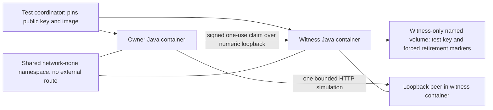

# Phase 13.11 — actual synthetic Java owner in a disposable sandbox

This is synthetic test evidence, not an operational service or approval. Existing
runtime code, trading code, historical evidence and governance decisions are unchanged.
The runtime JAR still contains 15 classes and no launcher. Three additional test-probe
classes run in an isolated image; JUnit, PostgreSQL and Testcontainers stay outside it.

## Runtime provenance

Adoptium's [container documentation](https://adoptium.net/installation/containers)
identifies Eclipse Temurin as an official Docker image. The separately published
[Docker official-images catalog](https://github.com/docker-library/official-images/blob/master/library/eclipse-temurin)
maps `21.0.12.1_1-jdk-noble`, amd64, to vendor commit
`511f9356dc4d50932a0a5f8cfb0f87ed1aef4f07`, `21/jdk/ubuntu/noble`.
The [immutable recipe](https://github.com/adoptium/containers/blob/511f9356dc4d50932a0a5f8cfb0f87ed1aef4f07/21/jdk/ubuntu/noble/Dockerfile)
matches the registry's source/revision annotations. The vendor release checksum
matches the recipe's Linux x64 JDK archive checksum. Raw metadata hashes and receipt
times are recorded in the Phase 13.11 manifest.

The Linux amd64 platform manifest is
`sha256:743b453cb8639d815a8251e128f7d8e88840c684e43fdbde1b1e79788437b5cf`.
The image index is `sha256:b468c3fc688b14450571494f588bd939378e7fd542ed5a73f8efc13f17872a87`;
config is `sha256:5b87e2cf305796b0082d40718341f9b75c2754e9cf81d228262b6902cae4e0b1`.
One immutable pull succeeded; compressed layers total 213,248,504 bytes, locally
reported image size 684,697,895 bytes. Java itself reported `21.0.12.1+1-LTS`.

Provenance classification: independently cross-checked official HTTPS publisher,
catalog and source linkage; registry content digests verified. Image signature/build
attestation was NOT independently authenticated. The Dockerfile's GPG/checksum commands
describe its build recipe; this phase did not rerun archive signature verification or
prove reproducible image construction. A digest alone is not publisher authentication.
The registry's linked in-toto SLSA v0.2 statement was also retrieved and hash-checked:
`f43f1db2c17065465ff78718b1ec21c978088eae1c71fa4b8614070b4ec93243`.
Its subjects bind the selected platform digest and its declared builder is
`https://github.com/docker-library`. This unsigned statement is supporting registry
metadata, not an independently authenticated signature. The linked SBOM descriptor
was recorded without downloading its body.

## Authority and isolation boundaries

The owner has no mounts. The image contains only an empty witness-directory seed;
the owner cannot see the witness volume/private key. The witness gets one owned,
disposable named volume, initialized only by explicit INITIALIZE on an empty fixture.
RECOVER loads the existing key and never resets spent IDs. Missing/corrupt keys fail
startup. The coordinator pins the public key; it is not a hardware root of trust.

The test-only witness serializes claims and creates a unique retired marker before
acknowledgment. It forces file contents and the containing directory, then signs the
attempt ID, request fingerprint, HALT fingerprint and fresh nonce. The request hash
binds owner incarnation, scope, route, expiry and proposal. A lost acknowledgment
leaves the marker spent and the owner sends nothing. Replacement owners cannot reuse
the ID, even with a different incarnation/request hash. Terminal observations never
remove retirement. No retry is implemented.

This forced-file witness is separate from the inherited PostgreSQL/coordinator
fixture. Tests of each are identified separately. It demonstrates process restart
with surviving storage, not sudden power-loss durability, replicated consensus or
resistance to privileged restoration of the witness volume/key/markers. Restoring
every authoritative store and trusted checkpoint still permits a second grant in
the inherited negative control, which performs no HTTP dispatch. That counterexample
remains unchanged.

## Measured containment

Every owner container is unprivileged UID/GID 65534, read-only root, ALL capabilities
dropped, no-new-privileges, private PID/IPC, no host binds/socket/secrets, 8 MiB bounded
scratch tmpfs, 256 MiB memory, one CPU and 64 PIDs. The image entrypoint is explicitly
Java, bypassing the vendor certificate helper. No runtime DNS or internet is needed.
The positive owner shares only the witness's isolated network-none namespace. The
negative Java probe uses its own network-none namespace under the same policy.

Java observed UID/GID, zero effective capabilities, NoNewPrivs=1, Seccomp=2, exact
cgroup limits, forbidden root-write failure, absent host/private-key paths, explicit
EPERM process-creation denial, ENETUNREACH for a documentation-address TCP attempt,
and UnknownHostException for a reserved invalid DNS name. Timeouts are not accepted
as proof. A scoped `/scratch` write succeeds. Docker inspect independently checks
namespace identity, mounts, privileges and limits for each fixture.

The Moby-derived default-deny seccomp policy removes fork/vfork and permits clone
only with CLONE_THREAD while preserving namespace exclusions. JVM threads and RSA
work with `--limit-modules java.base`. The measured ProcessBuilder path is denied;
the Ubuntu/JDK base still contains vendor-packaged native libraries, shells, GPG and
download utilities. Java module closure does not establish OS-package minimality.
These results do not prove resistance to arbitrary native code, exec replacement or kernel exploits.
AppArmor/SELinux enforcement was not established; the observed label was not an
enforcing docker-default profile. User namespaces were not remapped. Neither is
reported as a pass. Windows-host/privileged-Docker and production OS certification
remain outside the fixture assurance.

## Logging and retained operational denial

The owner emits only enumerated outcome/delivery and send counts. The peer returns
synthetic field-shape data, never authoritative funding evidence. Witness logs expose
only the public bootstrap key. Fake authentication canaries are generated internally,
not passed through environment/argv; raw signatures, private keys and bodies are not
logged. A deliberate uncaught canary exception uses a redacting test handler. Host
command output and Docker logs are scanned. JVM crash/heap dumps and future external
logging sinks are not universally certified by those checks.

V2 approval, four technical reviews and governance second review remain PENDING.
Implementation under V2 and real account access remain NOT_AUTHORIZED; operational
readiness NO_GO, collateral-assisted MIS NOT_READY. No broker session provenance,
independent live HALT or global trading DB nonmutation is established here.
