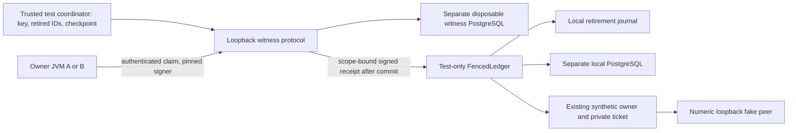

# Synthetic anti-rollback fencing and containment, Phase 13.9

This adds **test-only** fencing adapters and disposable policy probes. Runtime Java,
old fixtures/counterexamples, trading code and governance records are unchanged.
There is no deployed owner, real credential source, broker transport or launcher.
The old unfenced adapter remains intentionally available to its historical negative
tests. Claims below apply only to the explicitly composed FencedLedger fixture.

## Architecture decision and trusted root

| Candidate | Strength and cost | Decision |
|---|---|---|
| A: authenticated compare-and-advance witness, signed receipts | Separate coordinator and PostgreSQL container survive local-store restoration; bounded linearization and observable grants. Requires surviving trusted checkpoint/keys and explicit loss handling | Selected for disposable fixture |
| B: append-only sequence with externally retained signed checkpoints | Detects truncation only if an independent verifier retains a later checkpoint; requires external publication/custodian/availability protocol | Design only; no such external service is established |

Signatures/hash chains alone cannot detect restoration of every store, signer and
trusted checkpoint. Both architectures fail that universal claim. Keep
ANTI_ROLLBACK_UNRESOLVED and operational NO_GO.

Local rollback manipulates only the local database row/journal marker. The witness
uses another container, its own tables, and coordinator state outside both stores
and owner JVMs. This is distinct fixture rollback/failure scope, **not** separate
physical hardware, another host, a TPM or an independently operated organization.
Both containers and the coordinator remain controlled by one host administrator.

The coordinator is the explicit synthetic trusted root for its lifetime. It holds
RSA-3072 signing keys, root UUID, high-water checkpoint, and retired IDs. The witness
database persists unique claims and a root/sequence row with fsync, full_page_writes
and synchronous_commit ON. Coordinator loss without retained trusted state grants
nothing: no automatic key discovery, reset-to-genesis or reconstruction from a
possibly rolled-back database is implemented. Passing a restored old Root snapshot
is confined to the named adversarial counterexample, never a recovery procedure.

## Claim, acknowledgment and consumption

1. Trusted fixture bootstrap supplies a pinned root/public key/checkpoint and generated
   authentication canary over the child's private stdin, not argv/environment/logs.
   This is synthetic caller authorization, not broker identity or independent human
   approval. The bearer authenticates fixture callers; it does not provide TLS or
   protection against a privileged host observer.
2. The bounded numeric-loopback protocol sends attempt UUID, complete request digest,
   HALT digest, synthetic incarnation, expiry, epoch, previous checkpoint and fresh
   nonce. It accepts only bounded frames, the configured authentication and fixed
   fixture-time validity/epoch. No raw account/balance/credential payload is stored.
3. Retire the ID at the surviving coordinator before attempting persistence. Refuse
   duplicate IDs, stale checkpoints or invalid evidence. Reserve/advance the witness
   database transaction under row lock; require its root/sequence to match the retained
   checkpoint and durability settings. Unique ID and sequence update are atomic.
4. Only certain commit acknowledgment produces a signature covering domain version,
   root, every request field/nonce and next checkpoint. The client checks exact equality
   and the pinned RSA signature. There is no retry, receipt refresh or automatic renewal.
   A lost acknowledgment, bad signature or mismatch produces no local grant.
5. Only a verified witness claim may call the existing local durable consume method.
   Local write/ack failure remains spent at the witness. Only then may the existing
   owner construct a private ticket; it rechecks HALT/scope/expiry before send/result.
   Terminal outcomes are observations, never a refund or grant-renewal instruction.

Uncertain witness storage marks the coordinator quarantined. A detected DB sequence/
identity regression also quarantines it, even if a test later puts the row back.
Ordinary availability restoration does not clear quarantine. Pre-commit injected
failure can leave only the trusted coordinator retirement: its lifetime is therefore
part of the conditional guarantee, not a claim of durable hardware retirement.
The fixture uses fixed synthetic time; it is not a production trusted-clock service.
The root snapshot also retains quarantine; reconstructing the fixture with that
snapshot cannot clear a detected contradiction. The witness binds the opaque request
digest; the existing owner validates its decoded synthetic scope. This is not an
independent production approval engine or authenticated OS-incarnation authority.

## Assurance boundaries and negative controls

| Property | Classification and evidence |
|---|---|
| Surviving witness prevents local journal/DB rollback replay | PROVEN_IN_FIXTURE by FenceLedgerIT/FenceOwnerIT, conditional on retained coordinator and witness state |
| Existing unfenced dual-store rollback | NEGATIVE_DEMONSTRATED; unchanged IsolationLedgerIT still obtains a second grant, no HTTP in that negative control |
| Rollback of local stores, witness DB and trusted Root snapshot | NEGATIVE_DEMONSTRATED / UNRESOLVED; new ledger-only negative control obtains a second grant; universal guarantee cannot be established |
| Witness DB regression while high-water checkpoint survives | PROVEN_IN_FIXTURE denial/quarantine; not a hardware anti-rollback root |
| Witness DB process crash/restart | PROVEN_IN_FIXTURE with same coordinator and fresh Docker mapped-port inspection; no claim of witness-JVM or physical power-loss survival |
| Two independent owner JVMs and replacement | PROVEN_IN_FIXTURE for the selected shared witness; no multi-host/quorum failover claim |
| Missing root, bad signature/auth, stale checkpoint/epoch/expiry | PROVEN_IN_FIXTURE denial; availability and injected acknowledgment failures stay spent |
| Stale owner / delayed local acknowledgment | Fixture scope gate and fixed-clock expiry recheck; no independent OS process identity or live clock certification |
| Actual send delivery | Use NOT_DISPATCHED, MAY_HAVE_DISPATCHED, OBSERVED_COMPLETED; count attempts separately from peer-confirmed receipt |
| Physical torn sectors/cache/power failure, privileged complete restoration, multi-host split brain | NOT_TESTED / UNRESOLVED |

The detailed counts and run outcomes are in the validation report. Before reservation,
during reservation and lost-ACK cases are injections, not physical crash claims.
Existing parent-kill journal/DB/owner tests rerun unchanged. The fenced path exercises
all eight existing transport fault windows, acknowledgment loss before local writes,
local partial-write retirement, and expiry before dispatch. No exception establishes
that a remote peer did or did not receive bytes.

## Disposable OS policy, not owner deployment

Host discovery found Docker Desktop's WSL distribution and cached postgres/redis/
Ryuk/hello-world images, with no cached Linux JDK image. No image/JDK was pulled or
installed. ContainmentIT overrides the cached PostgreSQL image's entrypoint; it does
not start a trading app or use a trading DB. The probes use:

- Numeric UID/GID 65534, read-only root, dropped ALL capabilities and no-new-privileges.
- Explicit noexec/nosuid/nodev scratch tmpfs; read-only tmpfs masks the image's declared
  PG data volume. No bind/host/anonymous volume, daemon socket or secret mount.
- Network mode none, inspected before connection/DNS probes; no IPv4 non-loopback
  routes. Attempts target a documentation IP/invalid DNS name inside this namespace,
  never Kite or a real account endpoint. This is a kernel-policy denial test.
- 64 MiB memory, half-CPU bound and PID limits. A separate PID=1 shell probe must
  fail child creation; completion is not confused with successful execution.

Test results establish only the exercised shell/container policy. They do not run
the Java owner inside this sandbox. A PID=1 process cannot host an ordinary JVM with
threads; it is a denial probe, not a deployable JVM process policy. Local allowed HTTP
simulation remains in host-loopback fixtures, not certified in the sandbox. Mandatory
Java-owner containment therefore remains NOT_TESTED/UNRESOLVED and prevents a fully
validated Phase 13.9 result. A future separately scoped review needs an independently
verified Linux JDK artifact, JVM-compatible process restrictions and the complete
owner/witness/loopback flow inside the enforced boundary. No host firewall/global
Docker/security policy or live-service permission is changed here.
The long-lived network probe is inspected before its connection attempts. The
short-lived PID probe's configuration is inspected after its terminal exit; its
fixed create configuration and fork-denial diagnostic are the bounded evidence.

## Credential, logging and packaging boundary

Owner credentials remain generated-only in the unchanged runtime. The witness has
separate generated test signing/authentication material, never real credentials.
Root/client/adapter rendering is redacted. Request frames/receipts are an explicit
authorized synthetic control channel, not log output. No private signing key is
sent to an owner; authentication bootstrap uses stdin and response verification a
pinned public key. Privileged loopback capture, debugger and memory inspection remain
outside the fixture claim and require real OS controls before any future deployment.

Tests inspect owner console, bounded results, fake-peer wire, child output/stderr and
arguments for the authentication canary. Existing generated credential/signature/
serialization/error tests are retained. Surefire/Failsafe dumpstreams are inventoried,
not erased; Windows manifest-classpath diagnostics are distinct from crash dumps.
Container logs contain only bounded probe diagnostics. External logs, heap/core dumps,
JVM agents, environment capture and CI/IDE retention remain UNRESOLVED. No sensitive
payload is copied into research evidence; report hashes/counts and fixed labels only.

All new Java lives in src/test. The runtime still has 15 classes, no launcher/service
provider, no JDBC/Testcontainers/Spring/trading code, and java.base-only RSA providers.
Independent JAR inspection and restricted-JVM execution supplement jdeps. Root reactor
and all POM dependencies remain unchanged. Legacy unfenced fixtures are not silently
promoted to this new conditional guarantee.

V2, four review domains and governance second review PENDING; operational NO_GO,
MIS NOT_READY, real access/deployment/trading NOT_AUTHORIZED. Keep INR10,000/cash/CNC,
Phase12 BLOCK, H1/H2 FROZEN, July SEALED and Stage B ZERO_CALL_ABORT. No operational
read follows from this work.
