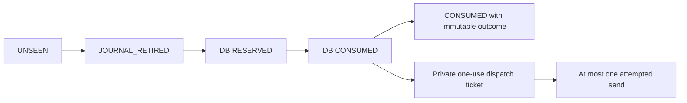

# Synthetic owner failure recovery — Phase 13.7

This hardens a fixture library, not a deployed service. Prototype `SyntheticOwner.v2`
is distinct from the still-pending `DiagnosticAssuranceContract.v2`. Historical
Phase13.6 documents/manifests and all governance generations remain unchanged.

## Actual boundary and changes

`SyntheticOwner`, `SyntheticHalt`, `LoopbackPeer` and their constructors are
package-private. There is no public service API, HTTP listener, launcher, production
token source or operational deployment. The standalone POM remains outside the root
reactor and trading classpath. Runtime uses java.base only, including its signing
provider (verified in a --limit-modules java.base subprocess). PostgreSQL, Testcontainers,
the retirement journal and subprocess main methods are in test sources only.

Owner entry point: `observe(Request, String, SyntheticHalt.Assertion, Fault)`.
The caller principal, fixture incarnation and fixed UTC clock come from trusted
synthetic fixtures, not a network identity provider. `Ledger.consume(Request,String)`
now binds an exact signed-HALT digest; its default denies, so a legacy ledger that
only implements `consume(Request)` cannot authorize owner dispatch. The one-argument
adapter method remains a ledger-only fixture with a zero digest, never an owner path.

Request fingerprint binds proposal identity, prototype version, one-use UUID, owner
incarnation, caller/recipient/account/purpose, exact method/URI, expiry and epoch.
Signed-HALT fingerprint additionally covers the length-framed assertion and signature.
Only digests are persisted, never keys, signatures, account payload or credentials.
This binds synthetic evidence; it establishes no human approval or live authority.

## Persistent retirement and legal transitions

There are no reverse or renewal edges. Every state after JOURNAL_RETIRED is spent,
including empty/partial markers, rollback, timeout, connection failure and unknown
commit acknowledgment. Outcomes are observations and cannot authorize another send.

1. Test initialization creates a unique, fixture-owned local journal directory and
   forced identity marker. A new adapter never silently creates/replaces that store.
2. Before contacting PostgreSQL, `AttemptJournal.retire` atomically CREATE_NEWs the
   UUID marker and forces it to storage. Existing markers deny regardless of contents.
   The marker contains request/HALT digests only. Missing/conflicting store identity,
   partial write or uncertain force denies. No routine repairs/deletes a spent marker.
3. PostgreSQL reservation commits separately, then conditional RESERVED -> CONSUMED
   commits. Both require the owned database marker and fsync, full_page_writes,
   synchronous_commit ON. Unique ID and exact request/HALT digests bind consumption.
4. Only certain consumption acknowledgment returns a grant. Lost reservation ACK,
   lost consume ACK, rollback or unavailable DB returns no grant; the local marker
   independently prevents reissue when the database is available again.
5. Terminal update requires CONSUMED and null outcome and exactly one updated row.
   Unknown IDs, RESERVED IDs and repeated/conflicting terminal updates throw a fixed
   bounded error. A terminal-write failure returns OUTCOME_UNKNOWN without refund.

The journal is a shared **test-only** persistent store across local workers and
subprocess restarts, not an in-memory durability substitute. It closes the prior
pre-reservation reissue gap under tested process-crash semantics. The database still
must durably consume before any socket path is reachable. Journal cleanup is allowed
only after terminating the entire owned fixture and its disposable DB; it is not an
attempt-recovery or reauthorization API. Each new test has a distinct fixture store.

Assumptions: all competing workers share the same journal/primary, local filesystem
supports atomic creation and force, and neither store is maliciously replaced or
rolled back. Directory metadata durability under power loss, replicated filesystems,
host rollback, deletion by privileged users and split-brain failover are **not**
certified. A future service would need independently enforced store identity,
durability, permissions, retention and distributed fencing. No production journal
adapter or independent reconciliation authority was implemented.

## Dispatch and uncertainty

Only the owner can construct a `DispatchTicket`, after its durable acknowledgment.
The ticket binds method/URI and atomically admits one transport invocation. The
transport rechecks owner authorization/HALT before socket creation and immediately
before send. It increments `attemptedSends` before the first possible request byte.
This is an attempted-send count, not a count of connections or inferred receipts.

The socket is explicitly `Proxy.NO_PROXY`, numeric 127.0.0.1, fixture-pinned port.
No DNS selector, proxy selector, redirects, retries or supplementary route exists.
Global proxy injection is tested using another loopback fixture. Environment and
property hazards retain fail-closed checks. Header/body limits and total read deadline
remain unchanged. No public-network probe is used as a negative test.

Allowed result fields are only `outcome`, `equityFieldPresent`, `delivery`:

| Delivery | Evidence meaning |
|---|---|
| NOT_DISPATCHED | Owner never entered send; a TCP connection may have existed |
| MAY_HAVE_DISPATCHED | First byte may have been attempted; no complete bounded exchange observed; remote receipt is not inferred |
| OBSERVED_COMPLETED | Complete bounded 2xx response body observed locally; not broker authority or successful business action |

Malformed complete body can be OBSERVED_COMPLETED with READ_DENIED. Non-2xx headers
deny without consuming their full body and conservatively remain MAY_HAVE_DISPATCHED.
Post-response fault or outcome-store failure can be OUTCOME_UNKNOWN with
OBSERVED_COMPLETED. The two dimensions deliberately do not imply retry permission.

## Crash-window evidence

All injections are labeled synthetic. Only rows explicitly marked subprocess or
database termination below use actual process/container death.

| Window | Method/evidence | Classification and remaining state |
|---|---|---|
| Before reservation | RecoveryLedgerIT BEFORE_RESERVATION/connection refusal after journal retirement | NOT_DISPATCHED; journal spent, DB ABSENT; new adapter denied |
| During reservation | DURING_RESERVATION rollback, PARTIAL_JOURNAL fixture | NOT_DISPATCHED; partial/complete marker spent; no DB grant |
| Before durable acknowledgment | AFTER_RESERVATION_BEFORE_ACK, BEFORE_COMMIT, AFTER_COMMIT_BEFORE_ACK | NOT_DISPATCHED; RESERVED or CONSUMED plus journal; replay denied |
| Immediately after consumption | LedgerIT actual LedgerWorker Runtime.halt after ACK; RecoveryOwnerIT owner fault then abrupt subprocess exit | NOT_DISPATCHED; CONSUMED; restarted worker/owner denied |
| Before socket creation | BEFORE_SOCKET injection | NOT_DISPATCHED, attempted sends 0, CONSUMED |
| Socket connected, before send | AFTER_SOCKET_BEFORE_SEND injection | NOT_DISPATCHED, attempted sends 0; no request receipt asserted |
| During send | DURING_SEND writes partial `GET ` then fails | MAY_HAVE_DISPATCHED; fixture separately observes partial bytes, not complete request |
| After send / remote receipt before response | AFTER_SEND injection; separate empty-response fixture confirms complete request header | MAY_HAVE_DISPATCHED; OUTCOME_UNKNOWN; no retry |
| During parsing | DURING_PARSE injection; truncation/timeout/slow peer/reset tests | MAY_HAVE_DISPATCHED; OUTCOME_UNKNOWN; no retry |
| Before outcome persistence | BEFORE_OUTCOME injection and existing terminal-write failure | OBSERVED_COMPLETED with OUTCOME_UNKNOWN; CONSUMED remains spent |

Also: eight thread claim race; two LedgerWorker processes; two full OwnerWorker JVMs
with different incarnations and the same ID yield exactly one attempted send and
one fixture-observed complete request. A third incarnation cannot revive the ID.
An old approval presented to a different owner incarnation denies before retirement.
The database crash test kills only its owned container, re-inspects its changed mapped
port, verifies persisted CONSUMED state and denies replay. These are not replicated
failover, independently authenticated owners or physical power-loss tests.

## HALT, containment and retained limits

The initial inherited Ed25519 profile required jdk.crypto.ec dynamically even though
jdeps reported java.base. [Plan amendment 1](../operations/phase-13.7-plan-amendment-1.md)
records that discovery without changing the original plan. The current synthetic
profile is RSA-3072/SHA256withRSA with payload domain SYNTHETIC_HALT_V2_RSA3072;
wrong algorithms and keys below 3072 bits deny. Tests inspect actual provider modules
and verify an assertion in a JVM restricted to java.base. This changes only generated
synthetic fixtures, not an approved/live cryptographic policy or historical evidence.

HALT epochs cannot decrease. A different public key cannot silently replace an
existing key ID. Clock reversal denies and marks the verifier unavailable; ordinary
clock recovery alone does not re-enable it. Existing signature/scope/expiry/nonce,
issuer availability, revocation and pre-dispatch/post-response checks remain. Trusted
fixture controls are not independently signed live HALT or operational policy.

Credentials remain generated-only, private and redacted. Native serialization of
credential, assertion, ticket and result objects denies. Result enums carry no raw
balance/account/signature. Success and non-2xx failure capture tests find no console
leak; fixtures deny all non-allowlisted logger/trace/metrics/dump categories. Subprocess
arguments contain only ports, public fixture/attempt identifiers, synthetic incarnation
and fault name; keys/credentials/assertions are generated inside the worker. Output
is a bounded attempted-send count and exit code. Journal files contain digests only.

No real logging backend, agent, heap/crash-dump, OS/IDE/container/proxy sink or hostile
reflective serializer is certified. No OS network sandbox or production identity/
permissions/deployment proof exists. Packaging checks prove only this artifact's
runtime dependencies, bytecode and absence of launcher/trading classes.

Operational NO_GO; V2/four reviews/governance second review PENDING; real Kite access
NOT_AUTHORIZED; real session/live HALT NOT_ESTABLISHED; live logs NOT_VERIFIED; MIS
NOT_READY. Phase12 BLOCK, H1/H2 FROZEN, July SEALED, StageB ZERO_CALL_ABORT and the
INR10,000/cash/CNC safeguards remain unchanged. A successful fixture cannot approve
any of those gates or prove global trading-database nonmutation.
