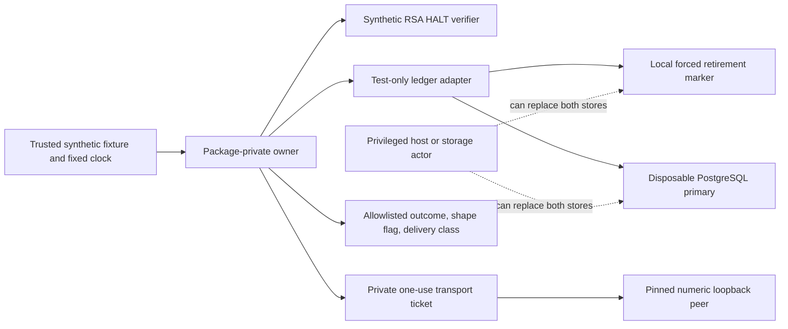

# Synthetic owner isolation and recovery assurance, Phase 13.8

This remains a library prototype, not a deployed credential owner. Its three
package-private runtime classes have no public service API or launcher. The
standalone module is outside the trading reactor. Test-only adapters own disposable
PostgreSQL and UUID-named journal directories; no trading store or broker credential
source is reused. Historical Phase 13.6 descriptions retain their original profile;
the current synthetic signing profile is RSA-3072/SHA256withRSA from java.base,
introduced and justified in the unchanged Phase 13.7 amendment.

The bounded assurance is at-most-once attempted dispatch assuming honest surviving
coordination state. It is **not resistant to privileged rollback of both stores**.
No exactly-once delivery, physical durability, OS sandbox or live certification is
claimed. The [validation report](../operations/phase-13.8-validation.md) records
actual execution and outstanding coverage.

## Trust boundaries and recovery



Request binding includes proposal identity, prototype version, ID, owner incarnation,
caller/recipient/account, purpose, exact method/route, validity and HALT epoch. The
ledger also binds the exact signed assertion digest. None of these synthetic claims
establishes real authentication origin or independent live HALT.

```text
UNSEEN -> JOURNAL_RETIRED -> DB_RESERVED -> DB_CONSUMED -> OUTCOME_RECORDED
                                     certain acknowledgment -> private ticket
```

An existing retirement marker denies even if empty or malformed. A failed file
create/write, uncertain acknowledgment or transaction rollback grants no ticket.
No success/failure label resets consumption. A process killed before marker creation
has not issued a grant; the fixture may subsequently claim that previously unissued
ID. A process killed after creation leaves it spent, including before file force.
That observation is process-crash evidence, not proof of power-loss durability.

New observers are confined to test adapters. They emit fixed stage labels then block
on the parent control pipe; closing the pipe terminates rather than resuming work.
The parent kills only its Process object, awaits termination and constructs a new
adapter/owner. No credential, signed assertion or account field is passed in process
arguments or stage output. SQL restoration tests delete only a random attempt row
in their Testcontainers-owned database. No operational reconciliation API is added.

## Evidence classification and failure windows

| Finding/window | Classification | Evidence and limit |
|---|---|---|
| Kill before journal creation | PROVEN_IN_DISPOSABLE_TEST | IsolationLedgerIT stage barrier; no marker/DB row/grant, subsequent first claim possible |
| Kill after create, after write, after force | PROVEN_IN_DISPOSABLE_TEST | Parent terminates JVM; marker survives and restarted adapter denies |
| Kill before/after reservation and consumption commits | PROVEN_IN_DISPOSABLE_TEST | Observed ABSENT/RESERVED/CONSUMED states; all retired IDs deny across restart |
| Uncertain DB acknowledgments and rollback | SYNTHETICALLY_MODELED | Existing explicit adapter faults; journal/row remain spent, grant denied |
| DB/container restart and concurrent JVMs | PROVEN_IN_DISPOSABLE_TEST | Existing LedgerIT/RecoveryOwnerIT; owned PG SIGKILL, fresh mapped-port inspection, one winner/send |
| Owner killed after durable claim before returning acknowledgment | PROVEN_IN_DISPOSABLE_TEST | IsolationOwnerIT AFTER_OWNER_ACK barrier is inside adapter return path, before ticket; peer receives zero |
| Owner killed after complete peer receipt before response | PROVEN_IN_DISPOSABLE_TEST | Parent waits for fake peer full-header receipt, kills worker; delivery MAY_HAVE_DISPATCHED from client perspective, no renewed send |
| Owner killed before terminal persistence | PROVEN_IN_DISPOSABLE_TEST | Barrier invoked by terminal callback after response processing; DB stays CONSUMED; replacement denies |
| Ticket/socket/partial-send/parse exact instruction windows | SYNTHETICALLY_MODELED | Existing eight owner faults; not actual instruction-level kill or physical NIC evidence |
| Create error and write exception | SYNTHETICALLY_MODELED | Fixture obstruction plus injected IOException chain; no disk-full or hardware damage |
| Truncation/stale marker contents | PROVEN_IN_DISPOSABLE_TEST | Actual fixture-file truncation/replacement; existence remains spent, no claim that tampering is authenticated |
| DB-only / journal-only logical rollback | SYNTHETICALLY_MODELED | Surviving store denies; test-controlled row/file removal models restoration |
| Whole-store logical rollback | SYNTHETICALLY_MODELED | Both prior records removed; second grant succeeds in ledger-only counterexample, with no HTTP |
| Physical power loss/cache/controller durability | UNVERIFIED | FileChannel.force and PostgreSQL fsync do not prove directory metadata or storage hardware behavior |
| Multi-host replicated failover/quorum/split-brain | UNVERIFIED | Two JVMs share one host journal and primary; no independent quorum or fencing authority |

The whole-store counterexample is a security limitation, not a regression assertion
that rollback is safe. An external non-rollbackable retirement authority, independently
fenced epoch or administrative reconciliation that never issues another send would
need a separately reviewed design. Hash equality, UUID directories and append-only
naming cannot supply that authority. Resetting a new HALT instance also does not
restore independent knowledge of prior epochs or revocations.

## HALT contradiction quarantine

Two new tests exposed that available(true) previously cleared denial following a
clock reversal or conflicting key-ID replacement. SyntheticHalt now retains a
separate irreversible quarantine flag for that verifier incarnation. Availability
recovery can restore an ordinary outage but cannot clear a trust/clock contradiction.
The flag and validation/key-rotation accesses share the existing synchronized
boundary. No new reset method or changed operational RuntimeTradingHalt is added.
Epoch rollback, nonce replay, expiry, scope, signature, revocation and pre-dispatch/
result rechecks remain covered. These tests are synthetic authority checks only.

## Network and process isolation

LoopbackPeer accepts only the pinned literal IPv4 127.0.0.1 GET/port/path. IPv6,
IPv4-mapped IPv6, abbreviated/octal/alternative loopback literals, hostnames, userinfo,
non-loopback documentation addresses and unsupported schemes are rejected by string
validation without DNS or connection. Proxy.NO_PROXY bypasses inherited selectors;
existing environment/property hazards deny. No external egress probe is performed.
Redirects/retries/supplementary requests remain prohibited. One send counter measures
attempts, not remote receipt. Bounded HTTP fixtures exercise timeout/reset/truncation,
oversized/malformed responses, non-2xx and post-response revocation.

| Future restriction | Current evidence | Remaining requirement |
|---|---|---|
| Separate OS identity and filesystem ACLs | UNVERIFIED; same test user | Independent identity/ACL inspection; deny trading/token-store volumes |
| Module/dependency boundary | PROVEN_IN_DISPOSABLE_TEST | Restricted java.base child with real RSA provider; independent JAR scan |
| Filesystem/process sandbox | PROVEN_IN_DISPOSABLE_TEST counterexample | A base-only child reads its own canary and spawns another child; module restriction is not a sandbox |
| Environment allowlist | DESIGNED_NOT_IMPLEMENTED | Current hazard denylist is not a complete environment allowlist or external attestation |
| Outbound OS network policy | DESIGNED_NOT_IMPLEMENTED | Application-level pinning only; require externally enforced egress policy |
| Inbound listeners | UNVERIFIED at OS level | No runtime listener API; tests can open loopback listeners under same user |
| Read-only root/capability restriction | DESIGNED_NOT_IMPLEMENTED | No owner container or minimal cached JDK sandbox image deployed |
| Privileged agents/debuggers/memory access | UNVERIFIED | Java encapsulation/zeroing does not constrain host administrator or injected code |

No host firewall, global Docker setting, live-service permission or OS policy was
changed. Using a PostgreSQL container does not certify isolation of the host JVM.

## Logging and credential containment

Generated synthetic entropy is private, has no import/export interface, is never
sent to the peer and is cleared on close. Allowlisted Result fields remain outcome,
equityFieldPresent and delivery. Native serialization denies capability/result
objects; rendering is redacted. No runtime logging/metrics/tracing framework exists.
The new nested exception test includes cause and suppressed canaries: owner handling
returns a bounded error with empty captured stdout/stderr and no attempt. Existing
success/failure wire/result tests cover credential/signature/account-like payloads.

| Sink | Evidence boundary |
|---|---|
| stdout/stderr and exception chains | Exercised captures and bounded error fields; no canary in result or current thread name |
| HTTP headers/body and serialized results | No credential/auth/cookie headers; fixture body is not emitted in result; native serialization denied |
| SLF4J/logback/files/metrics/traces/Actuator | Excluded runtime dependencies and sink-policy rejection; absence is not external sink attestation |
| Surefire/Failsafe/build reports | Scanned locally for known canary prefix, secret heuristics and generated dump artifacts; raw JVM properties not published |
| Heap/core/crash dumps, JVM diagnostics, IDE/debugger, CI, proxy/container/Windows event sinks | UNVERIFIED; no deliberate host crash/dump or real-log collection; hostCaptureDisabled remains a trusted fixture assertion |

No test establishes prevention of hostile reflective serialization or heap inspection.
Structured schema presence and synthetic amounts do not establish free/eligible
haircut-adjusted collateral or any NSE MIS cash-field mapping.

Governance/V2/four-domain approvals remain PENDING, live session/HALT NOT_ESTABLISHED,
live logs NOT_VERIFIED, real read/deployment/trading NOT_AUTHORIZED, operational NO_GO
and MIS NOT_READY. Own-process live noninterference and global DB invariance are not
certified. Phase12 BLOCK, H1/H2 FROZEN, July SEALED, INR10,000/cash/CNC and prior
Stage B ZERO_CALL_ABORT remain unchanged.
