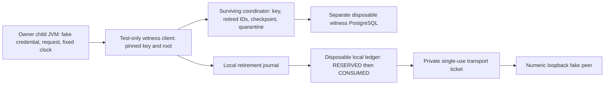

# Synthetic Java-owner sandbox and monotonic-root recovery

Phase 13.10 is a conditional recovery experiment, not deployment certification.
Actual owner runtime classes execute in host test JVMs. **JAVA_OWNER_SANDBOX_NOT_EXECUTED**:
no verified Linux JDK image/archive was available in the inspected local sources.
The installed Windows JDK has MZ binaries; copying it into a Linux image is not a
valid construction route. No runtime was downloaded, installed or built from
unverified components. Shell containment regressions do not replace this missing proof.

## Authority and persistence graph

The witness commits its claim and sequence before issuing a signed acknowledgment.
Only its verified receipt may precede local journal retirement, durable reservation,
durable consumption and private ticket creation. SyntheticOwner checks scope, caller,
expiry and synthetic HALT before claiming, before socket/send, and before accepting
the result. LoopbackPeer counts attempted sends before the first byte. Terminal
outcomes never refund an attempt. At-most-once attempt does not mean exactly-once
delivery: a valid attempt may deliver zero times.

The witness's monotonicity is conditional on an independently surviving fixture
coordinator/root. A signed checkpoint alone does not enforce progression. Both
PostgreSQL containers, journal and coordinator ultimately share a host administrator.
An ordinary child crash cannot reset the coordinator; a privileged actor can restore
every database, key and trusted checkpoint. The latter counterexample still obtains
two grants. It is NEGATIVE_DEMONSTRATED / UNRESOLVED, with no HTTP in that test.

## New recovery implementation boundary

RootRecoveryWorker is test-only. It invokes the same SyntheticOwner.observe path,
generated credential, RSA-3072 HALT verifier and LoopbackPeer as the existing fixture.
Its small Ledger wrapper preserves FencedLedger's witness-before-local ordering and
adds parent-controlled barriers. Private stdin supplies witness bootstrap material;
argv contains only synthetic routing/fixture identifiers. Lost input or unexpected
control data exits rather than continuing. The worker is excluded from the runtime JAR.

RootRecoveryIT kills that process at five barriers and starts a separately bootstrapped
replacement. The expected observations are deliberately distinct:

| Kill point | Local durable state | Peer receipts before/after replacement |
|---|---|---|
| After verified witness acknowledgment, before local write | ABSENT; witness ID retired | 0 / 0 |
| Before local consumption commit | RESERVED; transaction rolls back on death | 0 / 0 |
| After local consumption commit | CONSUMED | 0 / 0 |
| After complete request received, before response release | CONSUMED; MAY_HAVE_DISPATCHED from owner's perspective | 1 / 1 |
| Before outcome persistence after parsed response | CONSUMED; response observation reached | 1 / 1 |

All replacements must deny and report zero attempted sends. Killed workers cannot
report final results; peer observation and persisted state provide the asserted
evidence. No claim about unobserved bytes is inferred from termination alone.

Additional cases reconstruct the witness from retained state after lost ACK, reject
a conflicting pinned signing key, terminate on lost barrier stdin, and reject a new
root against an existing witness database after simulated checkpoint loss. Quarantine
must survive availability toggles and reconstruction. Rebuilding from explicitly
retained in-memory Root is not restoration from physical power loss or proof that
keys/checkpoints can be safely recovered after their destruction.

Existing tests cover pre-reservation unavailability, injected reservation/ACK faults,
duplicate IDs, stale checkpoint/epoch, two independent owner JVMs, PostgreSQL restart,
dual-local-store rollback, HALT key conflicts/clock reversal and full-authority rollback.
The old negative controls are unchanged. Stale-checkpoint denial is not a full
network adversary replay campaign. Multi-host split brain and quorum recovery remain
unverified. No automatic genesis, quarantine clearing or spent-ID renewal is added.

## Sandbox evidence and missing controls

Docker reported builtin seccomp and cgroup namespaces. That host capability listing
is not measurement of an actual Java process's effective profile. Only docker-desktop
WSL and the cached postgres/redis/Ryuk/hello-world images were discovered. Repository
archive searches and installed-JDK inspection did not establish a verified Linux JVM.
The missing user .jdks directory was recorded, not assumed to contain an installation.

| Required Java-owner restriction | Phase 13.10 status |
|---|---|
| Non-root UID/GID, zero effective capabilities, no-new-privileges | NOT_TESTED in Java sandbox |
| Read-only root, scoped writable scratch, excluded host/trading mounts | NOT_TESTED in Java sandbox |
| JVM-compatible PID/memory/CPU policy and forbidden process creation | NOT_TESTED |
| Measured seccomp/AppArmor and user-namespace mapping | NOT_TESTED; host capability listing only |
| Default-deny DNS/external TCP and allowed numeric loopback from Java | NOT_TESTED under OS policy |
| Java sandbox logs, uncaught failure, termination and diagnostic containment | NOT_TESTED |

The existing shell probes run as regression coverage only. Their PID=1 denial policy
cannot host a normal multithreaded JVM. Java URL validation and --limit-modules
java.base remain useful software/package controls, not an OS sandbox. No host firewall,
global Docker policy, WSL configuration or production service permission is altered.

## Logging and packaging

New workers print only fixed barrier labels; parent checks child stderr against an
exact tooling-diagnostic allowlist and rejects the generated authentication canary.
Unexpected diagnostic text fails with a fixed error label, without echoing captured
payload. Amendment 1 records the initial empty-stderr test failure and correction.
Existing redaction/serialization tests rerun. Report/dumpstream hashes and provenance
are retained; local scanning is not external sink/heap/core/IDE/CI certification.

Runtime remains the three unchanged source classes, 15 compiled classes, java.base
only including actual RSA provider execution, and no launcher or credential loader.
PostgreSQL, witness and process entrypoints remain test-only, outside the trading
reactor. There is no production security fix or deployed recovery mechanism here.

Operational NO_GO; V2, four domains and governance second review PENDING; real access
NOT_AUTHORIZED; MIS NOT_READY. Preserve INR10,000, Phase12 BLOCK, H1/H2 FROZEN, July
SEALED and Stage B ZERO_CALL_ABORT. Physical power loss, privileged rollback, multi-host
failover, real authentication/live HALT and operational OS/log certification remain open.
