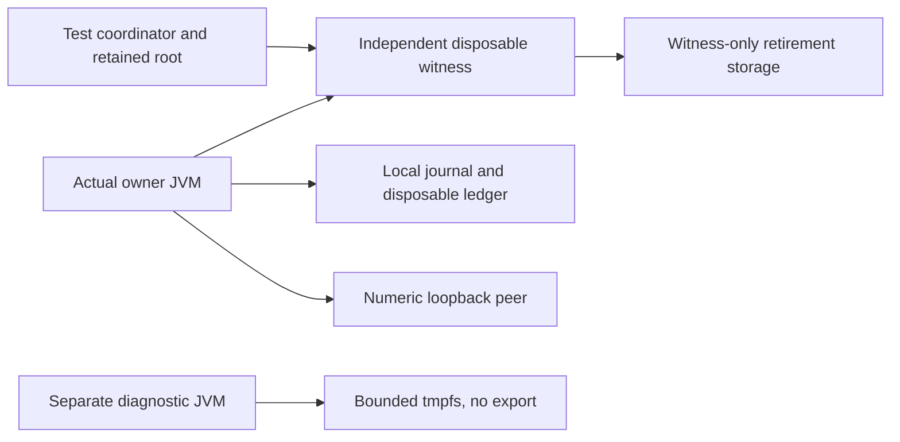

# Synthetic owner sandbox security closure: Phase 13.12

This phase adds diagnostic tests, not an operational credential owner. The existing
runtime, sandbox owner/witness fixtures, policy and historical evidence are unchanged.
Synthetic results cannot approve V2, complete human technical reviews or authorize
implementation under V2, real account access, deployment or trading.

## Image identity and authenticity

The base remains docker.io/library/eclipse-temurin, Linux amd64,
`sha256:743b453cb8639d815a8251e128f7d8e88840c684e43fdbde1b1e79788437b5cf`.
Its registered source is vendor commit `511f9356dc4d50932a0a5f8cfb0f87ed1aef4f07`,
21/jdk/ubuntu/noble, version 21.0.12.1_1-jdk-noble. Identity is checked against
cached index/platform/config metadata and the local image's rootfs chain. New
test images use COPY-only builds without pulling or build-network access.

[Adoptium container guidance](https://adoptium.net/installation/containers) identifies
the official image. Its [GPG guidance](https://adoptium.net/installation/gpg-verification)
describes signatures for downloaded JDK artifacts. That does not by itself authenticate
this OCI manifest or prove execution of its build recipe. The retained registry SLSA
statement has no authenticated signature. No trusted digest-bound OCI signer chain
has been verified; IMAGE_SIGNATURE_NOT_VERIFIED remains a mandatory gap.

The registry-linked SPDX body is content-verified against its registered descriptor.
It inventories image packages independently of Java module closure. Neither an SBOM
nor java.base closure proves the Ubuntu/JDK image minimal or vulnerability-free.

## Diagnostic boundary

DiagnosticsProbe and SandboxDiagnosticsIT are test-only. The diagnostic image contains
only that probe above the vendor base; the actual owner runs separately using the
unchanged JavaSandboxIT request path. Diagnostics do not replace actual-owner tests.

Heap pressure is capped inside a 24 MiB JVM heap and 256 MiB container. A deliberately
generated canary-bearing heap dump goes only to a 48 MiB tmpfs. In-container scanning
emits filename, size, digest and presence boolean, never dump contents. The heap is
expected to contain the canary: it is not called clean. A changed destination on the
read-only root must fail. No host bind or export is permitted. Container removal
disposes the volatile tmpfs; physical secure erasure and privileged-host access are
not established by that disposal.

A separate deliberate native fault uses a test-only java.base Unsafe reflection
opening. The actual owner never receives that opening. Core generation is disabled
and the error-log destination is bounded scratch. The negative case selects a
forbidden root destination and checks fallback artifacts. Native diagnostics may
expose addresses and configuration even when the synthetic canary is absent; this
is not proof that arbitrary future heap/register contents cannot leak.

The attachment test explicitly disables the Attach mechanism and invokes jcmd against
the waiting diagnostic JVM. JFR's absence from the module-limited owner is measured
separately; it does not mean a full JDK cannot run JFR. Existing tests cover unsafe
sink configuration, redacted exception paths, one-use responses and forbidden process
creation. No policy is relaxed for diagnostic convenience.

## Authority and rollback limits

Surviving witness/root state fences restored local stores. Retirement precedes any
usable dispatch ticket; uncertain acknowledgment denies another attempt. At-most-once
attempted dispatch is not exactly-once delivery. Restoring every authoritative store
and trusted checkpoint still permits a second grant in the retained no-HTTP negative
test. Signing a checkpoint cannot create monotonicity when the signer and root are
also restorable. Physical power loss, privileged rollback and multi-host consensus
remain unproven.

LSM enforcement and UID remapping require effective kernel evidence and attributable
denials. Seccomp, UID 65534 and a read-only root cannot substitute for either control.
Unavailable backend support is reported as a gap; no host profile/daemon modification
is authorized. See the validation report for fresh observations and exact test counts.
